<h1 align="center">Usage Limits Bar commands</h1>

<a href="COMMANDS.md">Русский</a> · <b>English</b> · <a href="README.en.md">← back to the plugin overview</a>

  <a href="#show-and-hide-the-bar">Show / hide</a> ·
  <a href="#skins">Skins</a> ·
  <a href="#bar-length">Length</a> ·
  <a href="#color-thresholds">Colors</a> ·
  <a href="#which-windows-to-show">Windows</a> ·
  <a href="#reset-time">Reset time</a> ·
  <a href="#icons">Icons</a> ·
  <a href="#language">Language</a> ·
  <a href="#exact-values">Exact values</a>

Type all commands at the Claude Code prompt. Any command without a value shows the current setting and a hint, for example `/limits width` → "Bar length: 8 cells. Change: /limits width 4…16". All settings are remembered between launches.

The pictures show an example: the 5-hour session is 36% used, the week is 50% used.

## Show and hide the bar
`/limits` hides the bar; run `/limits` again to show it.

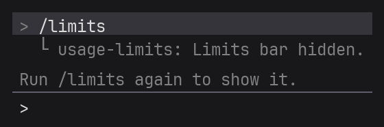

You can also collapse the bar with the Claude Code shortcut **Ctrl+X**, then **Ctrl+A**.

## Skins
`/limits skin` lists the skins with a preview; the current one is marked `●`.

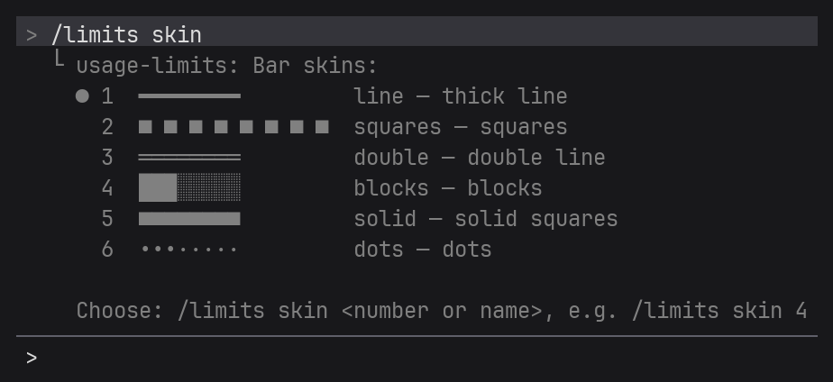

`/limits skin <number or name>` chooses a skin, for example `/limits skin 4` or `/limits skin blocks`.

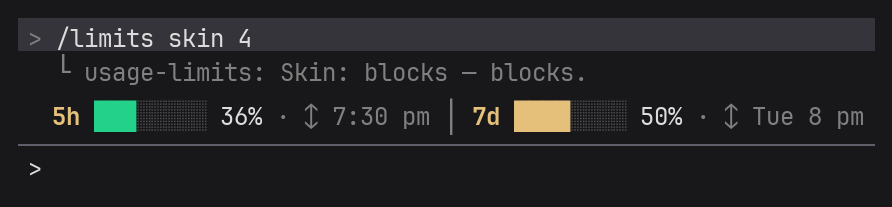

## Bar length
`/limits width 4…16` sets the bar length in cells; the default is 8. A longer bar shows usage more precisely but takes more room.

**4 — the shortest**

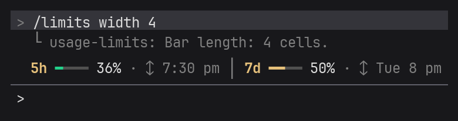

**8 — default**

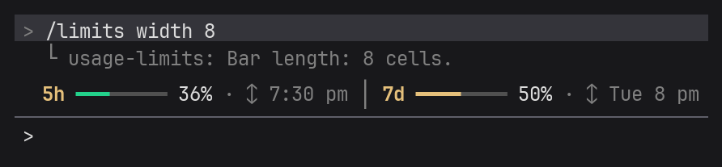

**16 — the longest**

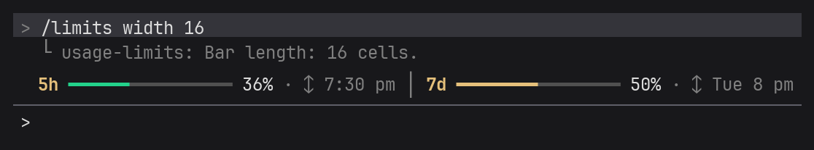

## Color thresholds
`/limits colors <yellow> <red>` sets the percentage at which the bar turns yellow and red. The brackets say what color each window is in the picture.

**50 and 80 — default: green below 50%, yellow below 80%, red above** (45% is green, 75% is yellow)

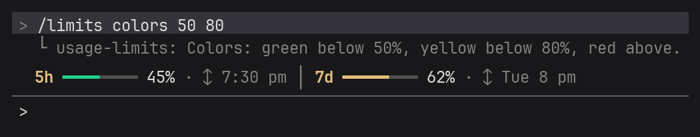

**70 and 90 — calmer: green below 70%, yellow below 90%, red above** (68% is still green, 85% is still yellow; with the default thresholds they would be yellow and red)

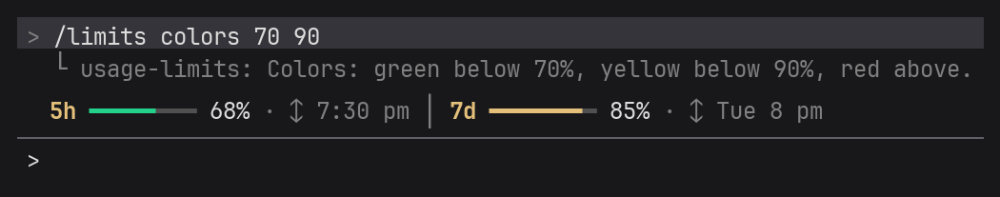

**30 and 60 — stricter: yellow from 30%, red from 60%** (45% is yellow, 75% is red)

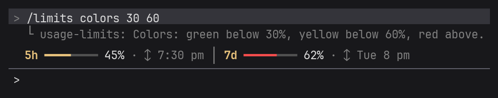

The first number must be smaller than the second, both from 1 to 100. Otherwise the plugin shows the right format.

## Which windows to show
`/limits show <value>` chooses which limits the bar shows.

**`both` — both windows (default)**

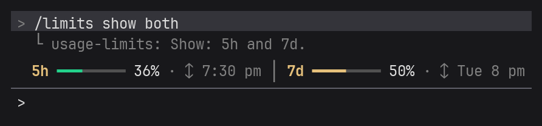

**`5h` — the 5-hour session only**

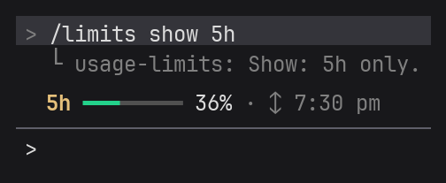

**`7d` — the week only**

## Reset time
`/limits time <value>` chooses whether to show when the limit starts over.

**`on` — show (default)**

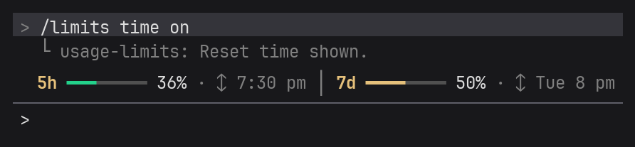

**`off` — hide**

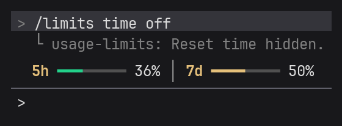

## Icons
`/limits icons nerd` turns on clock, calendar and refresh icons; `/limits icons off` turns them off. A Nerd Font is needed in the terminal — see [Icons](README.en.md#icons) in the plugin overview.

## Language
`/limits lang en` / `ru` switches to English or Russian; `/limits lang auto` follows the system region settings (default).

**`en` — English**

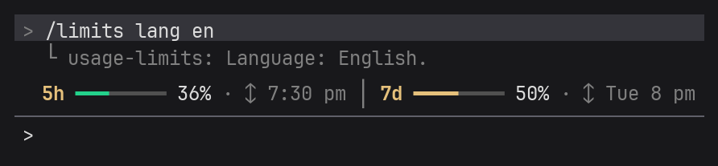

**`ru` — Russian**

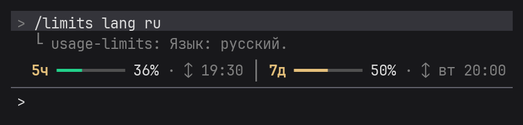

## Exact values
`/limits debug` shows the percentages, the reset time, when the numbers last changed and when the plugin last checked them. Handy to compare the bar with `/usage`.

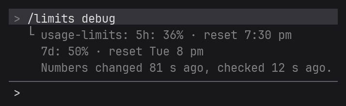

