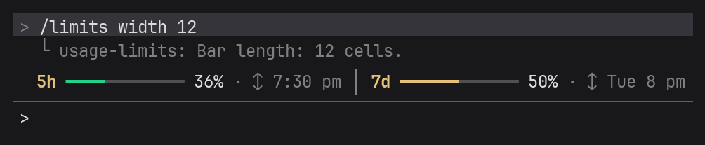
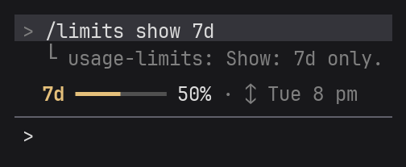

<h1 align="center">Usage Limits Bar commands</h1>

<a href="COMMANDS.md">Русский</a> · <b>English</b> · <a href="README.en.md">← back to the plugin overview</a>

  <a href="#show-and-hide-the-bar">Show / hide</a> ·
  <a href="#skins">Skins</a> ·
  <a href="#bar-length">Length</a> ·
  <a href="#color-thresholds">Colors</a> ·
  <a href="#which-windows-to-show">Windows</a> ·
  <a href="#reset-time">Reset time</a> ·
  <a href="#icons">Icons</a> ·
  <a href="#language">Language</a> ·
  <a href="#exact-values">Exact values</a>

Type all commands at the Claude Code prompt. Any command without a value shows the current setting and a hint, for example `/limits width` → "Bar length: 8 cells. Change: /limits width 4…16". All settings are remembered between launches.

The pictures show an example: the 5-hour session is 36% used, the week is 50% used.

## Show and hide the bar
`/limits` hides the bar; run `/limits` again to show it.

You can also collapse the bar with the Claude Code shortcut **Ctrl+X**, then **Ctrl+A**.

## Skins
`/limits skin` lists the skins with a preview; the current one is marked `●`.

`/limits skin <number or name>` chooses a skin, for example `/limits skin 4` or `/limits skin blocks`.

## Bar length
`/limits width 4…16` sets the bar length in cells; the default is 8.

## Color thresholds
`/limits colors <yellow> <red>` sets the percentage at which the bar turns yellow and red. The default is 50 and 80: green below 50%, yellow below 80%, red above.

The first number must be smaller than the second, both from 1 to 100. Otherwise the plugin shows the right format.

## Which windows to show
`/limits show both` shows both windows (default), `/limits show 5h` only the 5-hour session, `/limits show 7d` only the week.

## Reset time
`/limits time off` hides the reset time; `/limits time on` shows it again (default).

## Icons
`/limits icons nerd` turns on clock, calendar and refresh icons; `/limits icons off` turns them off. A Nerd Font is needed in the terminal — see [Icons](README.en.md#icons) in the plugin overview.

## Language
`/limits lang en` / `ru` switches to English or Russian; `/limits lang auto` follows the system region settings (default).

## Exact values
`/limits debug` shows the percentages, the reset time, when the numbers last changed and when the plugin last checked them. Handy to compare the bar with `/usage`.

