<h1 align="center">Команды Usage Limits Bar</h1>

<b>Русский</b> · <a href="COMMANDS.en.md">English</a> · <a href="README.md">← к описанию плагина</a>

  <a href="#показать-и-скрыть-полоску">Показать / скрыть</a> ·
  <a href="#скины">Скины</a> ·
  <a href="#длина-полоски">Длина</a> ·
  <a href="#пороги-цветов">Цвета</a> ·
  <a href="#какие-окна-показывать">Окна</a> ·
  <a href="#время-сброса">Время сброса</a> ·
  <a href="#иконки">Иконки</a> ·
  <a href="#язык">Язык</a> ·
  <a href="#точные-значения">Точные значения</a>

Все команды вводятся в поле ввода Claude Code. Любая команда без значения показывает текущую настройку и подсказку, например `/limits width` → «Длина полоски: 8 делений. Изменить: /limits width 4…16». Все настройки сохраняются между запусками.

На картинках — пример: 5-часовая сессия израсходована на 36%, неделя — на 50%.

## Показать и скрыть полоску
`/limits` — скрыть полоску, повторный `/limits` — показать снова.

Свернуть полоску можно и сочетанием клавиш Claude Code: **Ctrl+X**, затем **Ctrl+A**.

## Скины
`/limits skin` — список скинов с превью, текущий отмечен `●`.

`/limits skin <номер или имя>` — выбрать скин, например `/limits skin 4` или `/limits skin blocks`.

## Длина полоски
`/limits width 4…16` — длина полоски в делениях, по умолчанию 8. Чем длиннее полоска, тем точнее видно расход, но тем больше места она занимает.

**4 — самая короткая**

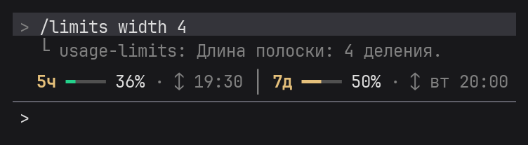

**8 — по умолчанию**

**16 — самая длинная**

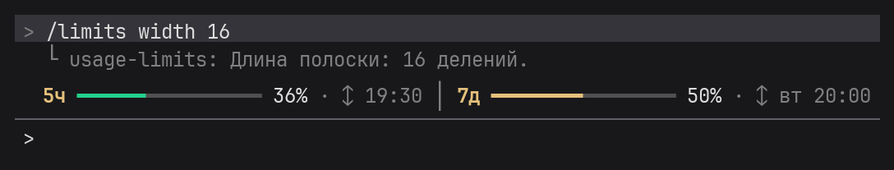

## Пороги цветов
`/limits colors <жёлтый> <красный>` — с какого процента полоска желтеет и краснеет. В скобках — какого цвета на картинке каждое окно.

**50 и 80 — по умолчанию: зелёный до 50%, жёлтый до 80%, дальше красный** (45% — зелёный, 75% — жёлтый)

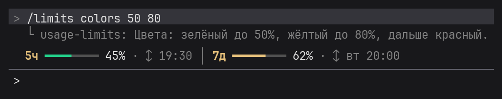

**70 и 90 — спокойнее: зелёный до 70%, жёлтый до 90%, дальше красный** (68% — ещё зелёный, 85% — ещё жёлтый; при порогах по умолчанию были бы жёлтый и красный)

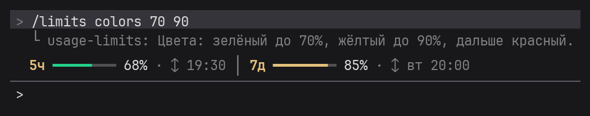

**30 и 60 — строже: жёлтый уже с 30%, красный с 60%** (45% — жёлтый, 75% — красный)

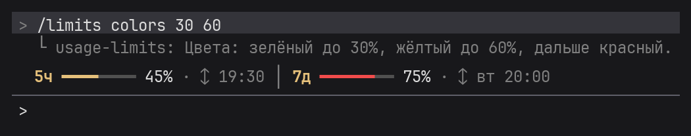

Первое число должно быть меньше второго, оба — от 1 до 100. Иначе плагин подскажет правильный формат.

## Какие окна показывать
`/limits show <значение>` — какие лимиты выводить в полоске.

**`both` — оба окна (по умолчанию)**

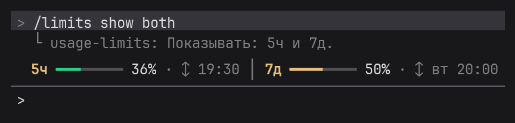

**`5h` — только 5-часовая сессия**

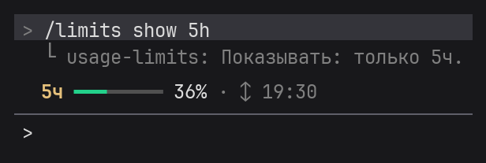

**`7d` — только неделя**

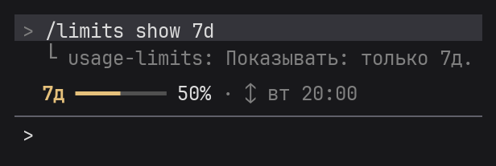

## Время сброса
`/limits time <значение>` — показывать ли время, когда лимит снова обнулится.

**`on` — показывать (по умолчанию)**

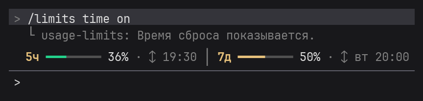

**`off` — скрыть**

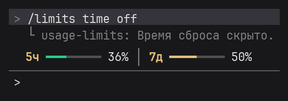

## Иконки
`/limits icons nerd` — значки часов, календаря и обновления, `/limits icons off` — выключить. Нужен шрифт Nerd Font в терминале — подробнее в разделе [Иконки](README.md#иконки) описания плагина.

## Язык
`/limits lang ru` / `en` — русский или английский, `/limits lang auto` — по региональным настройкам системы (по умолчанию).

**`ru` — русский**

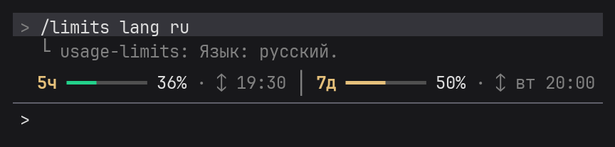

**`en` — английский**

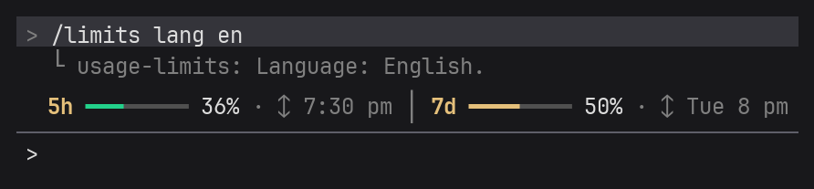

## Точные значения
`/limits debug` — проценты, время сброса, когда цифры менялись и когда плагин последний раз их проверял. Удобно, чтобы сверить полоску с `/usage`.

