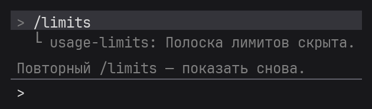
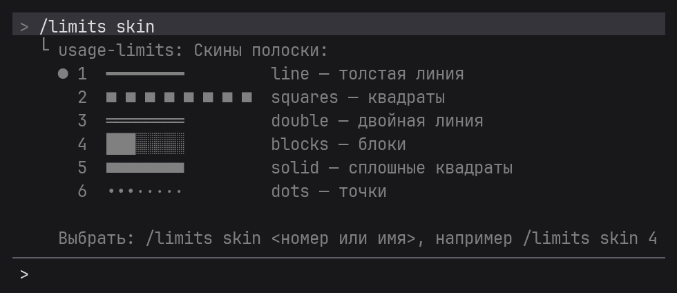
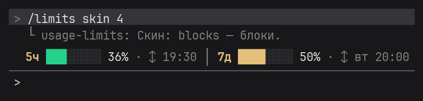
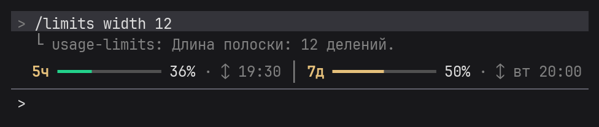
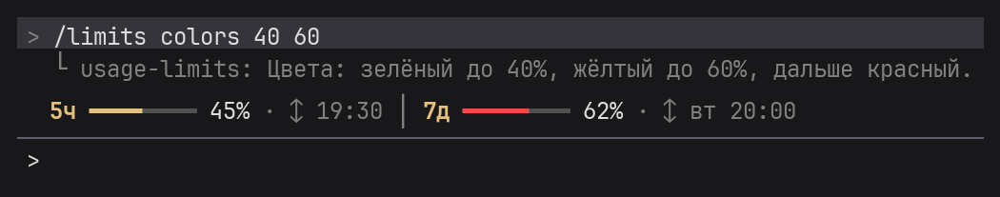
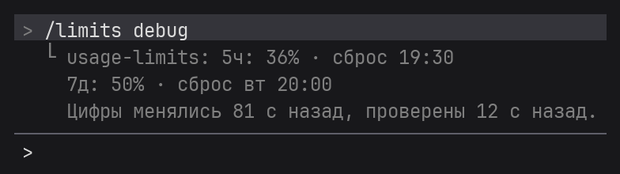

<h1 align="center">Команды Usage Limits Bar</h1>

<b>Русский</b> · <a href="COMMANDS.en.md">English</a> · <a href="README.md">← к описанию плагина</a>

  <a href="#показать-и-скрыть-полоску">Показать / скрыть</a> ·
  <a href="#скины">Скины</a> ·
  <a href="#длина-полоски">Длина</a> ·
  <a href="#пороги-цветов">Цвета</a> ·
  <a href="#какие-окна-показывать">Окна</a> ·
  <a href="#время-сброса">Время сброса</a> ·
  <a href="#иконки">Иконки</a> ·
  <a href="#язык">Язык</a> ·
  <a href="#точные-значения">Точные значения</a>

Все команды вводятся в поле ввода Claude Code. Любая команда без значения показывает текущую настройку и подсказку, например `/limits width` → «Длина полоски: 8 делений. Изменить: /limits width 4…16». Все настройки сохраняются между запусками.

На картинках — пример: 5-часовая сессия израсходована на 36%, неделя — на 50%.

## Показать и скрыть полоску
`/limits` — скрыть полоску, повторный `/limits` — показать снова.

Свернуть полоску можно и сочетанием клавиш Claude Code: **Ctrl+X**, затем **Ctrl+A**.

## Скины
`/limits skin` — список скинов с превью, текущий отмечен `●`.

`/limits skin <номер или имя>` — выбрать скин, например `/limits skin 4` или `/limits skin blocks`.

## Длина полоски
`/limits width 4…16` — длина полоски в делениях, по умолчанию 8.

## Пороги цветов
`/limits colors <жёлтый> <красный>` — с какого процента полоска желтеет и краснеет. По умолчанию 50 и 80: зелёный до 50%, жёлтый до 80%, дальше красный.

Первое число должно быть меньше второго, оба — от 1 до 100. Иначе плагин подскажет правильный формат.

## Какие окна показывать
`/limits show both` — оба окна (по умолчанию), `/limits show 5h` — только 5-часовую сессию, `/limits show 7d` — только неделю.

## Время сброса
`/limits time off` — скрыть время сброса, `/limits time on` — показывать снова (по умолчанию).

## Иконки
`/limits icons nerd` — значки часов, календаря и обновления, `/limits icons off` — выключить. Нужен шрифт Nerd Font в терминале — подробнее в разделе [Иконки](README.md#иконки) описания плагина.

## Язык
`/limits lang ru` / `en` — русский или английский, `/limits lang auto` — по региональным настройкам системы (по умолчанию).

## Точные значения
`/limits debug` — проценты, время сброса, когда цифры менялись и когда плагин последний раз их проверял. Удобно, чтобы сверить полоску с `/usage`.

