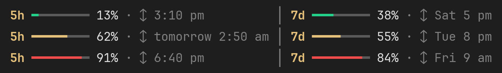
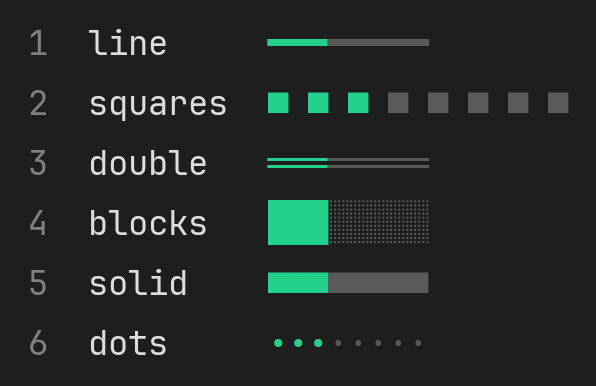
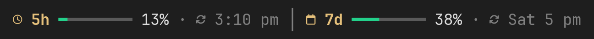

<p align="center">
  
</p>
<h1 align="center">Usage Limits Bar</h1>

<p align="center"><a href="README.md">Русский</a> · <b>English</b></p>

<p align="center">
  <a href="#about">About</a> ·
  <a href="#installation">Installation</a> ·
  <a href="#commands">Commands</a> ·
  <a href="#skins">Skins</a> ·
  <a href="#icons">Icons</a> ·
  <a href="#language">Language</a> ·
  <a href="#limitations">Limitations</a> ·
  <a href="#update-and-removal">Update and removal</a> ·
  <a href="#support-the-project">Support the project</a> ·
  <a href="#license">License</a>
</p>

## About
A [Claude Code](https://claude.com/claude-code) plugin that shows your subscription usage right above the prompt. No more typing `/usage` every time you want to know how much is left.

<p align="center"></p>

What the bar shows:
- **5h** — usage of the five-hour session;
- **7d** — usage of the weekly limit;
- usage percentage — the filled part changes color: green below 50%, yellow from 50% to 80%, red from 80% to 100% (the thresholds can be changed with `/limits colors`);
- limit reset time — the time when the limit starts over is shown in one of the following formats:
  - "3:10 pm" — if the reset happens today;
  - "tomorrow 2:50 am" — if it happens the next day;
  - "Sat 5 pm" — if it happens on a specific day of the week.

  The plugin takes the time zone and time format from the system settings: on Windows from the region settings (Settings → Time & language → Region), on macOS from Language & Region, on Linux from the locale. Daylight saving time is taken into account: if the clocks change before the limit resets, the reset time is shown in the new time.

  With a 12-hour format the time is shown as "3:10 pm", with a 24-hour format as "15:10".

The bar updates on its own after every Claude reply. At startup, before the first reply, it shows the last known numbers marked "(last session)".


In a narrow terminal window the bar shortens itself: first it drops the reset time, and if there is still not enough room, the week block.

## Installation


At the Claude Code prompt:

```
/plugin install usage-limits --marketplace IlTsPe/usage-limits-bar
```

Answer `y` to `Add marketplace?`, then pick the install scope (the default is your user, i.e. every project) and press Enter.

From a regular terminal, the same in one command:

```
claude plugin install usage-limits --marketplace IlTsPe/usage-limits-bar
```

In the Claude desktop app: "+" next to the prompt → Plugins → Add marketplace → `IlTsPe/usage-limits-bar` → Add plugin.

## Commands
Type all commands at the Claude Code prompt. For more detail, with a picture for each command, see [COMMANDS.en.md](COMMANDS.en.md).

| Command | What it does |
| --- | --- |
| `/limits` | Hide or show the bar. The choice is remembered between launches |
| `/limits skin` | List the skins with a preview; the current one is marked `●` |
| `/limits skin <number or name>` | Choose a skin, e.g. `/limits skin 4` or `/limits skin blocks` |
| `/limits width 4…16` | Bar length in cells, e.g. `/limits width 12` (default 8) |
| `/limits colors <yellow> <red>` | Color thresholds, e.g. `/limits colors 70 90`: green below 70%, yellow below 90%, red above (default 50 and 80) |
| `/limits show both` / `5h` / `7d` | Which windows to show: both, 5h only or 7d only |
| `/limits time on` / `off` | Show or hide the reset time |
| `/limits icons` | Show whether icons are on |
| `/limits icons nerd` | Turn on Nerd Font icons (clock, calendar, refresh arrow) |
| `/limits icons off` | Turn icons off |
| `/limits lang` | Show the current language |
| `/limits lang en` / `ru` | Switch to English or Russian |
| `/limits lang auto` | Language from the system region settings (default) |
| `/limits debug` | Exact values, when the numbers last changed and when the plugin last checked them — to compare with `/usage` |

You can also collapse the bar with the Claude Code shortcut **Ctrl+X**, then **Ctrl+A**.

## Skins
A skin changes how the bar looks. All skins work with the standard fonts of Windows, macOS and Linux.

<p align="center"></p>

The look depends on the terminal font: for example, in the standard Windows console the squares of the `solid` skin have small gaps between them.

## Icons
By default the plugin uses only characters that every font has. For nicer icons (a clock, a calendar and a refresh arrow) you need a font from the [Nerd Fonts](https://www.nerdfonts.com/) family.

This is how the bar looks with icons:

<p align="center"></p>

How to turn them on:

1. Download and install any Nerd Font, for example [JetBrainsMono Nerd Font](https://github.com/ryanoasis/nerd-fonts/releases/latest/download/JetBrainsMono.zip). Pick the **Mono** variant (on Windows it is named, for example, "JetBrainsMono NFM"): all its icons are one cell wide, so the line does not shift.

   Only fonts with **Nerd Font**, **NF** or **NFM** in their name have the icons. Regular versions such as "JetBrains Mono", "JetBrains Mono NL" or "JetBrains Mono Light" have no icons, even when installed next to a Nerd Font.
2. Select that font in your terminal:
   - **PowerShell and cmd** — right-click the window title → Properties → Font;
   - **VS Code** — in `settings.json`: `"terminal.integrated.fontFamily": "'JetBrainsMono NFM'"`;
   - **Git Bash** — right-click the window → Options → Text → Font;
   - **Windows Terminal, iTerm2 and others** — in the profile settings.
3. Turn the icons on: `/limits icons nerd`.

If you see boxes instead of icons, the terminal uses a font without icons: a regular version instead of the Nerd Font. Turn the icons off with `/limits icons off`.

## Language
The plugin supports English and Russian. The interface language is detected automatically:

- on Windows — from the region settings (Settings → Time & language → Region);
- on macOS and Linux — from the `LANG` variable.

If the region is set to Russia, the interface is in Russian; in all other cases it is in English. The language of the operating system itself does not affect the choice: for example, even if Windows is in English but the region is set to Russia, the plugin shows its text in Russian.

| | English | Русский |
| --- | --- | --- |
| Bar | `5h ━━━━━━━━ 13% · ↕ 3:10 pm` | `5ч ━━━━━━━━ 13% · ↕ 15:10` |
| Tomorrow | `↕ tomorrow 2:50 am` | `↕ завтра 2:50` |
| Another day | `↕ Sat 5 pm` | `↕ сб 17:00` |

The time format follows your system settings, not the interface language: for example, with a 24-hour format the time is shown as "Sat 17:00" even in English.

To choose the language manually, use these commands:

- `/limits lang en` — English;
- `/limits lang ru` — Russian.

To go back to automatic language detection, type: `/limits lang auto`.

## Limitations
- The bar shows usage as of Claude's last reply: the server sends the numbers with the reply, before that reply itself is counted. So it may lag behind `/usage` by 1–2% until the next reply arrives. Usage in other Claude Code windows, on claude.ai and by background agents also shows up only with the next reply in this session.
- Works when you sign in to Claude Code with a Claude subscription (Pro, Max). With an API key there are no "5 hours / week" limits, so the bar stays empty.
- The bar shows in Claude Code in a terminal (PowerShell, cmd, Git Bash, the VS Code terminal, Windows Terminal, iTerm2, etc.) and in the desktop app. It does not show in the Claude Code extension panel for VS Code, in the browser or in the mobile app; use `/usage` there.
- The time format (12 or 24 hours) and the time zone come from the system settings. Tested on Windows; on macOS and Linux it works by the same rules but has been checked only by tests.
- The plugin uses the Claude Code plugin API, which is still in early access (the plugin is tested on Claude Code 2.1.318). After major Claude Code updates the plugin may need an update.

## Update and removal
Update to the latest version:

```
claude plugin update usage-limits@usage-limits-bar
```

Restart Claude Code after the update.

Remove:

```
claude plugin uninstall usage-limits@usage-limits-bar
```

## Support the project
The plugin is free. If it helps you and you want to thank the author, support the project on [DonationAlerts](https://www.donationalerts.com/r/pegasusil). It helps keep the plugin going and make new ones.

Found a bug or have an idea? Open an [issue](https://github.com/IlTsPe/usage-limits-bar/issues).

## License
© 2026 Ilya Tsygankov. The plugin is distributed under the [MIT](LICENSE) license: you may use it for free, change it, share it and use it in your own projects, including commercial ones. The only condition is to keep the copyright line and the license text in all copies.

The plugin is provided "as is", without warranty. Full text: [LICENSE](LICENSE).

Claude and Claude Code are Anthropic products. This plugin is an independent project and is not affiliated with Anthropic.
