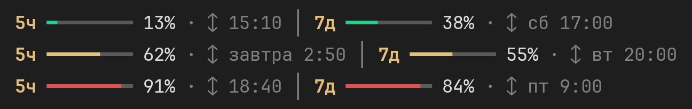
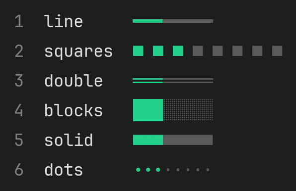
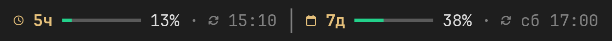

<p align="center">
  
</p>
<h1 align="center">Usage Limits Bar</h1>

<p align="center"><b>Русский</b> · <a href="README.en.md">English</a></p>

<p align="center">
  <a href="#о-плагине">О плагине</a> ·
  <a href="#установка">Установка</a> ·
  <a href="#команды">Команды</a> ·
  <a href="#скины">Скины</a> ·
  <a href="#иконки">Иконки</a> ·
  <a href="#язык">Язык</a> ·
  <a href="#ограничения">Ограничения</a> ·
  <a href="#обновление-и-удаление">Обновление и удаление</a> ·
  <a href="#поддержать-проект">Поддержать проект</a> ·
  <a href="#права">Права</a>
</p>

## О плагине
Плагин для [Claude Code](https://claude.com/claude-code), который показывает расход лимитов подписки прямо над полем ввода. Больше не нужно каждый раз вводить `/usage`, чтобы узнать, сколько осталось.

<p align="center"></p>

Что показывает полоска:
- **5ч** — расход пятичасовой сессии;
- **7д** — расход недельного лимита;
- процент расхода — заполненная часть меняет цвет: зелёный до 50%, от 50% до 80% — жёлтый, от 80% до 100% — красный (пороги можно поменять командой `/limits colors`);
- время обновления лимита — время, когда лимит снова обнулится, отображается в одном из следующих форматов:
  - «15:10» — если сброс произойдёт сегодня;
  - «завтра 2:50» — если на следующий день;
  - «сб 17:00» — если в определённый день недели.

  Плагин берет часовой пояс и формат времени из настроек системы: в Windows — из региональных настроек («Параметры» → «Время и язык» → «Регион»), в macOS — из настроек «Язык и регион», в Linux — из локали. Переход на летнее и зимнее время учитывается: если часы переведут до сброса лимита, время сброса будет показано уже по новому времени.

  При 24‑часовом формате время будет показано как «15:10», при 12‑часовом — «3:10 дня» (или на английском — «3:10 pm»).

Полоска обновляется сама после каждого ответа Claude. При запуске, пока ответа ещё не было, показываются последние известные цифры с пометкой «из прошлой сессии».


В узком окне терминала полоска сокращается сама: сначала убирает время обновления, а если места всё равно мало — блок недели.

## Установка


В поле ввода Claude Code:

```
/plugin install usage-limits --marketplace IlTsPe/usage-limits-bar
```

На вопрос `Add marketplace?` ответьте `y`, затем выберите область установки (по умолчанию — для пользователя, то есть во всех проектах) и нажмите Enter.

Из обычного терминала то же самое делается одной командой:

```
claude plugin install usage-limits --marketplace IlTsPe/usage-limits-bar
```

В десктоп-приложении Claude: «+» рядом с полем ввода → Plugins → Add marketplace → `IlTsPe/usage-limits-bar` → Add plugin.

## Команды
Все команды вводятся в поле ввода Claude Code. Подробнее, с картинками по каждой команде, — на странице [COMMANDS.md](COMMANDS.md).

| Команда | Что делает |
| --- | --- |
| `/limits` | Скрыть или показать полоску. Выбор запоминается между запусками |
| `/limits skin` | Список скинов с превью; текущий отмечен `●` |
| `/limits skin <номер или имя>` | Выбрать скин, например `/limits skin 4` или `/limits skin blocks` |
| `/limits width 4…16` | Длина полоски в делениях, например `/limits width 12` (по умолчанию 8) |
| `/limits colors <жёлтый> <красный>` | Пороги цветов, например `/limits colors 70 90`: зелёный до 70%, жёлтый до 90%, дальше красный (по умолчанию 50 и 80) |
| `/limits show both` / `5h` / `7d` | Какие окна показывать: оба, только 5ч или только 7д |
| `/limits time on` / `off` | Показывать или скрыть время сброса |
| `/limits icons` | Показать, включены ли иконки |
| `/limits icons nerd` | Включить иконки Nerd Font (часы, календарь, стрелка обновления) |
| `/limits icons off` | Выключить иконки |
| `/limits lang` | Показать текущий язык |
| `/limits lang ru` / `en` | Включить русский или английский язык |
| `/limits lang auto` | Язык по региональным настройкам системы (по умолчанию) |
| `/limits debug` | Точные значения, когда цифры менялись и когда плагин их последний раз проверял — чтобы сверить с `/usage` |

Свернуть полоску можно и сочетанием клавиш Claude Code: **Ctrl+X**, затем **Ctrl+A**.

## Скины
Скин меняет вид полоски. Все скины работают в стандартных шрифтах Windows, macOS и Linux.

<p align="center"></p>

Вид зависит от шрифта терминала: например, в стандартной консоли Windows квадраты скина `solid` стоят с небольшими промежутками.

## Иконки
По умолчанию плагин использует только символы, которые есть в любом шрифте. Если хочется красивых иконок — часов, календаря и стрелки обновления, — нужен шрифт из семейства [Nerd Fonts](https://www.nerdfonts.com/).

Так выглядит полоска с иконками:

<p align="center"></p>

Как включить:

1. Скачайте и установите любой Nerd Font, например [JetBrainsMono Nerd Font](https://github.com/ryanoasis/nerd-fonts/releases/latest/download/JetBrainsMono.zip). Берите вариант **Mono** (в Windows он называется, например, «JetBrainsMono NFM») — в нём все значки шириной в одну ячейку, и строка не съезжает.

   Иконки есть только в шрифтах, в названии которых есть **Nerd Font**, **NF** или **NFM**. Обычные версии шрифтов — например, «JetBrains Mono», «JetBrains Mono NL» или «JetBrains Mono Light» — иконок не содержат, даже если установлены рядом с Nerd Font.
2. Выберите этот шрифт в своём терминале:
   - **PowerShell и cmd** — правой кнопкой по заголовку окна → «Свойства» → «Шрифт»;
   - **VS Code** — в `settings.json`: `"terminal.integrated.fontFamily": "'JetBrainsMono NFM'"`;
   - **Git Bash** — правой кнопкой по окну → Options → Text → Font;
   - **Windows Terminal, iTerm2 и другие** — в настройках профиля.
3. Включите иконки: `/limits icons nerd`.

Если вместо значков видны квадратики, значит, в терминале выбран шрифт без иконок — обычная версия вместо Nerd Font. Выключите иконки командой `/limits icons off`.

## Язык
Плагин поддерживает русский и английский языки. Язык интерфейса определяется автоматически:

- в Windows — по региональным настройкам («Параметры» → «Время и язык» → «Регион»);
- в macOS и Linux — по переменной `LANG`.

Если указан русский регион, интерфейс будет на русском, в остальных случаях — на английском. При этом язык самой операционной системы не влияет на выбор: например, даже если Windows на английском, но регион задан как русский, плагин отобразит текст на русском языке.

| | Русский | English |
| --- | --- | --- |
| Полоска | `5ч ━━━━━━━━ 13% · ↕ 15:10` | `5h ━━━━━━━━ 13% · ↕ 3:10 pm` |
| Завтра | `↕ завтра 2:50` | `↕ tomorrow 2:50 am` |
| Другой день | `↕ сб 17:00` | `↕ Sat 5 pm` |

Формат отображения времени соответствует системным настройкам, а не языку интерфейса: например, при 24‑часовом формате даже на английском языке время будет показано как «Sat 17:00».

Для ручного выбора языка используйте команды:

- `/limits lang ru` — русский язык;
- `/limits lang en` — английский язык.

Чтобы вернуться к автоматическому определению языка, введите: `/limits lang auto`.

## Ограничения
- Полоска показывает расход на момент последнего ответа Claude: сервер присылает цифры вместе с ответом, ещё без учёта самого этого ответа. Поэтому она может отставать от `/usage` на 1–2%, пока не придёт следующий ответ. Расход в других окнах Claude Code, на claude.ai и у фоновых агентов тоже появится только со следующим ответом в этой сессии.
- Работает при входе в Claude Code через подписку Claude (Pro, Max). При работе через API-ключ лимитов «5 часов / неделя» нет — полоска останется пустой.
- Полоска видна в Claude Code в терминале (PowerShell, cmd, Git Bash, терминал VS Code, Windows Terminal, iTerm2 и др.) и в десктоп-приложении. В панели расширения Claude Code для VS Code, в браузере и в мобильном приложении её нет — там лимиты смотрите через `/usage`.
- Формат времени (12 или 24 часа) и часовой пояс берутся из настроек системы. Проверено на Windows; на macOS и Linux работает по тем же правилам, но проверено только тестами.
- Плагин использует API плагинов Claude Code, которое пока находится в раннем доступе (плагин проверен на Claude Code 2.1.318). После крупных обновлений Claude Code может понадобиться обновить плагин.

## Обновление и удаление
Что изменилось в каждой версии — в [CHANGELOG.md](CHANGELOG.md).

Обновить до последней версии:

```
claude plugin update usage-limits@usage-limits-bar
```

После обновления перезапустите Claude Code.

Удалить:

```
claude plugin uninstall usage-limits@usage-limits-bar
```

## Поддержать проект
Плагин бесплатный. Если он вам пригодился и хочется сказать спасибо автору — поддержите проект на [DonationAlerts](https://www.donationalerts.com/r/pegasusil). Это помогает развивать плагин и делать новые.

Нашли ошибку или есть идея — откройте [issue](https://github.com/IlTsPe/usage-limits-bar/issues).

## Права
© 2026 Илья Цыганков. Плагин распространяется по лицензии [MIT](LICENSE): им можно бесплатно пользоваться, изменять, распространять и использовать в своих проектах, в том числе коммерческих. Единственное условие — сохранять строку с авторскими правами и текст лицензии во всех копиях.

Плагин предоставляется «как есть», без гарантий. Полный текст — в файле [LICENSE](LICENSE) (на английском).

Claude и Claude Code — продукты Anthropic. Плагин — независимый проект и не связан с Anthropic.
